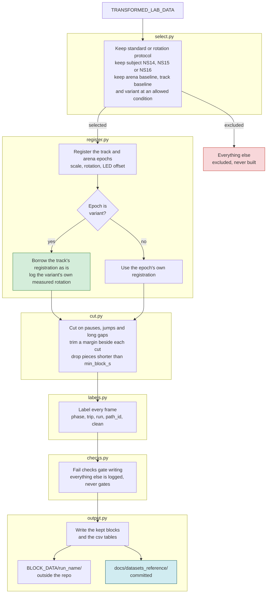

# Block datasets: the pipeline and the schema

What `scripts/build_blocks/` does, and exactly what it writes. Kept up to date with the code
in `scripts/build_blocks/`, not with the design discussion in `tmp/`.

## Pipeline

### Reading the diagram

Each box group is one module in `scripts/build_blocks/`, in the order a session passes
through them, top to bottom. A session or epoch can only leave the pipeline early at the red
box in `select.py`. From `register.py` onward, every selected epoch is carried all the way
through to `output.py`.

**select.py.** The only hard filter. A session is kept when its protocol is `standard` or
`rotation` and its subject is `NS14`, `NS15` or `NS16`, narrowed further by
`build_protocol.yaml`'s own `rat` setting. Within a kept session, only the arena and track
epochs tagged `baseline`, and a variant epoch tagged with one of `build_protocol.yaml`'s
`conditions`, are selected. Nothing else in the pipeline excludes a session or a block. The
`verdict` column reserved on every output row is for a person to exclude one by hand, later,
without rebuilding.

**register.py, the scale.** The track's pixels per metre is the span between the outermost occupancy
peaks of the running frames along each room axis, divided by the distance between the centre lines
of the opposite perimeter return corridors (the paper's envelope less one corridor width, 1.52 by
1.17 m). On the real maze the outermost running is the rat's return around the perimeter, not the
goal arms. The arena's scale is the track's times the parallax ratio.

**register.py, the green box.** A rotation session's `variant` epoch does not get its own
registration. The camera never moved between epochs, so the track epoch's own scale, rotation
and offset are reused as they are. The variant epoch's own rotation is measured separately,
but only to log it as `maze_deg_measured` and to check it against the condition's nominal
angle in `checks.py`. This is the one piece of science logic in the redesign: reuse the
track's transform, never re-derive one from the variant epoch's own frames.

**cut.py.** A session is cut on pauses in the time column, single-frame position jumps, and
tracking gaps longer than `max_gap_frames`. A margin is trimmed beside each cut so a block
never starts or ends right up against one. Dwells, the animal stationary at a reward site
eating, are never a cut. The animal is tracked normally there, so it stays inside its block
and is labelled `dwell` or `pause` by `labels.py` instead.

**checks.py.** Two checks gate whether a block is written at all: a block with any NaN
position or an irregular time step is dropped, and a variant block whose measured rotation
sits too far from its condition's nominal angle is dropped. Every other check, registration
warnings, the heading offset, how much running time sits on the track, overlapping blocks, is
written to `checks.json` regardless of its result. Nothing here reviews a session before it
is written. A viz checker to look over a build after the fact is planned but not yet built.

**output.py.** Every run writes a new, timestamped folder under `BLOCK_DATA`, never
overwriting an earlier one. `BLOCK_DATA` itself stays outside the repo, like every other data
folder. The one thing committed to the repo is `docs/datasets_reference/`, a small record of
every run that ever happened, kept separate from the data itself.

## `BLOCK_DATA/<run_name>/`

`<run_name>` is `<timestamp>_<description>`, for example `2026-10-28T140500Z_first-build`. One
such folder per `pixi run build-blocks` run.

### `blocks.csv`

One row per kept block.

| field | meaning |
|---|---|
| `block_id` | `{session_id}_{epoch}_{NN}`, numbered within the epoch |
| `session_id`, `subject_id`, `protocol` | from `sessions.csv` |
| `environment`, `epoch` | the epoch's own fields, `epoch` is `arena`, `track` or `variant` |
| `frame_start`, `frame_end` | 1-based inclusive frame range in the session |
| `n_frames`, `duration_s`, `rate_hz` | block length |
| `n_runs`, `n_clean_runs` | distinct lab-labelled runs touching the block, and the clean-flagged subset |
| `n_trips`, `n_complete_trips` | distinct outbound-to-next-outbound trips, and the subset whose outbound and return both lie inside the block |
| `heading_lost_s` | seconds with no head direction at all, NaN after filling |
| `heading_filled_s` | seconds whose heading was filled in, a short loss, repaired |
| `heading_held_s` | seconds whose heading was held from the last good value, a longer loss |
| `scale_px_per_m`, `rotation_rad` | this block's epoch's own registration |
| `maze_deg_measured` | a variant block's own measured rotation in degrees, empty otherwise |
| `verdict` | always `"ok"` as written, reserved for later hand exclusion |

### `sessions.csv`

One row per session that built at all. `session_id`, `subject_id`, `protocol`, `rate_hz`,
`n_blocks`, `verdict` (always `"ok"`). A session that failed to build, no track epoch
selected, or its blocks overlapped, has no row here. See `manifest.json`'s `failed` map for
why.

### `cuts.csv`

One row per session per epoch, where its frames went. `session_id`, `epoch`, then four frame
counts that sum to the epoch's total frame count. `block` ended up in a kept block, `margin`
was trimmed beside a pause, jump or gap, `gap` sat inside a tracking gap over
`max_gap_frames`, `dropped` is left over, a piece shorter than `min_block_s`.

### `frames/{block_id}.parquet`

One file per kept block, one row per frame.

| column | meaning |
|---|---|
| `frame` | the session's 1-based frame number, int32 |
| `t` | seconds from the block's own first frame |
| `x`, `y` | position in room metres |
| `heading` | head direction in room radians, filled or held, never raw |
| `speed`, `turn_rate` | from the room position and heading |
| `heading_filled`, `heading_held` | which repair, if any, covers this frame |
| `phase` | `outbound`, `dwell`, `return`, `pause` or `forage` |
| `trip` | signed trip number, 0 in the arena, negative when incomplete inside this block |
| `run`, `path_id` | the lab's own run number and path id, 0 outside any run |
| `clean` | the lab's own clean flag, painted across the run |

### `checks.json`

One entry per session that built, keyed by `session_id`. `registration` holds the parameters that
placed every block, by epoch: the scale, rotation and offset, and for the track its x and y scale
estimates and `start_offset_measured_m`, how far the start site sits above the bottom perimeter
corridor. `warnings` holds each epoch's
`registration_warnings`, plus `heading` and `on_track`, each a `{status, detail}` map.
`cut_counts` holds that session's `cuts.csv` rows, by epoch. `skipped_blocks` lists the blocks
that failed `block_fails` or `rotation_mismatch_fail` and were never written, with why.

### `manifest.json`

One per run. `run_name`, `git_commit`, `protocol` (the resolved `build_protocol.yaml`,
conditions as a list), `input_manifest_timestamp` (TRANSFORMED_LAB_DATA's own build time, for
provenance), `counts` (`sessions_selected`, `sessions_built`, `sessions_failed`,
`blocks_written`), `failed` (`session_id` mapped to a reason, for the ones that did not
build), `content_hash` (sha256 over `blocks.csv` then every block parquet, in path order).

## `docs/datasets_reference/`

Committed, inside the repo. `BLOCK_DATA` itself lives outside the repo, like every other data
folder. This is the small, committed record of every run that ever happened.

- `datasets.csv`. One row appended per run. `name`, `timestamp`, `commit`, `description`,
  `n_sessions`, `n_blocks`, `content_hash`.
- `<run_name>.yaml`. The `build_protocol.yaml` that produced that run, copied verbatim, so the
  registry's row stays reproducible even after the live file changes.
